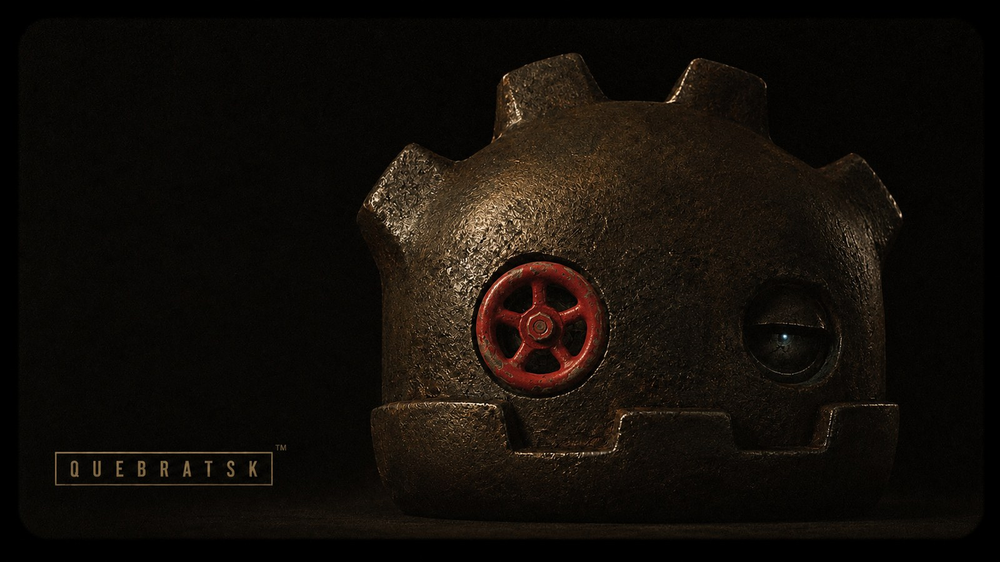
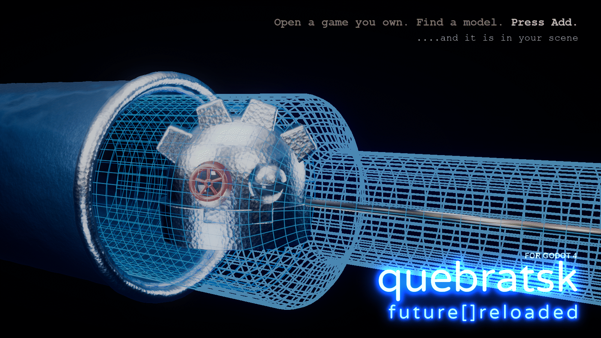
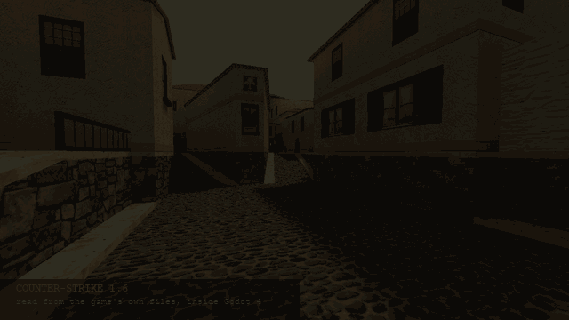
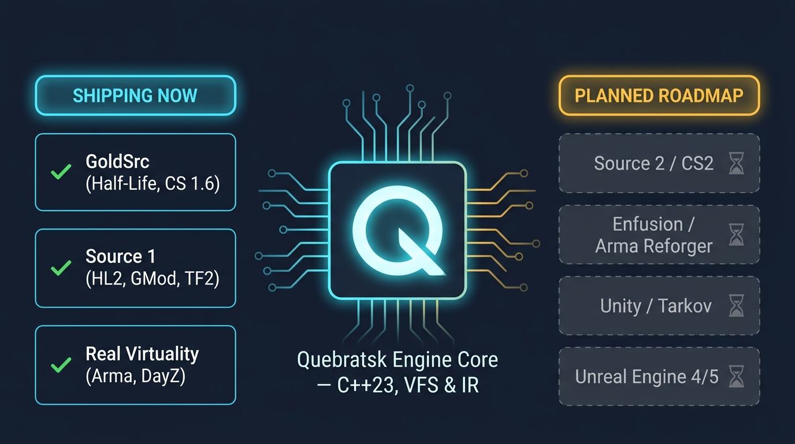

<p align="center">
  
</p>

<h1 align="center">Quebratsk</h1>

<p align="center">
  <b>Open a game you own. Find a model. Press Add. It is in your scene.</b>
</p>

<p align="center">
  <a href="LICENSE"></a>
  <a href="https://godotengine.org"></a>
  <a href="https://en.cppreference.com/w/cpp/23"></a>
  <a href="../../actions/workflows/build.yml"></a>
  <a href="docs/TUTORIAL.md"></a>
</p>

<p align="center">
  
</p>

Quebratsk is a Godot 4 plugin, written in C++, that reads the files of games you
already have installed and turns them into Godot meshes, skeletons, animations,
materials, sounds and whole levels. You don't export or convert anything first: it
reads each game where it sits, Steam Workshop content included.

It started as a way back into the Half-Life and Counter-Strike files many of us grew
up with. Those models still carry every animation and sound someone made for them,
and almost nothing modern can open them.

<p align="center">
  
</p>

## What it reads

| Engine | Games | State |
|---|---|---|
| GoldSrc | Half-Life, Counter-Strike, Condition Zero, Opposing Force, Blue Shift | Maps, models, animations, sounds. Done. |
| Source | Half-Life 2 and episodes, Garry's Mod, Counter-Strike: Source | Models, materials, animations, soundscripts and particles. Maps read too, tested on one level so far. |
| Real Virtuality | Arma, DayZ | Archives and textures. Retail models (ODOL) and terrain are next. |

Some numbers from retail installs: 122 of 123 surfaces textured on a downloaded
GoldSrc map, 111 sequences on the Counter-Strike terrorist, 244 of 253 map sounds
found, and 40 of 40 Source models fully textured. [CHANGELOG.md](CHANGELOG.md) has
the measurement behind each change.

<p align="center">
  
</p>

## Roadmap

After Source maps are finished come BeamNG.drive and then Grand Theft Auto from San
Andreas on. Neither is started.

## Getting started

1. Download the latest `quebratsk-*.zip` from Releases.
2. Unzip it into your Godot project, next to `project.godot`. You get two folders: `bin/`
   (the engine) and `addons/quebratsk_editor/` (the panel).
3. Close Godot and open the project again, so it loads the engine.
4. Open **Project → Project Settings → Plugins** and tick **Quebratsk**.

A panel appears on the left. Press **Add a game** and pick one from the list, which
covers Steam libraries on every drive. If yours is missing, **Browse for a folder**
works with game folders, extracted assets and single archives. Adding a game reads
its index only, so it is quick and takes no disk space.

Type in the search box, or narrow it with the categories (characters, weapons,
props, levels, sounds, textures) and the game dropdown. Select something to preview
it, then:

- **Add to scene** drops it into the open scene.
- **Save** writes it to `res://imported/` as a normal Godot scene. Use this for real
  projects: the saved scene loads without Quebratsk and without the game installed.

Models come in standing still. Tick **Bring it in moving** to get either the one
sequence you picked, or the usual moves (idle, walk, run, crouch, jump, shoot,
reload, die) as an `AnimationPlayer`. A Condition Zero player has 494 sequences, so
the second option saves you reading the list.

[docs/TUTORIAL.md](docs/TUTORIAL.md) walks through all of this step by step.

## The lab

`demo/` is a Godot project whose main scene, `demo/lab/`, mounts Counter-Strike 1.6,
opens a map and puts you in it with a weapon and some company. Every model, texture,
animation and sound comes from your own install at startup. Open `demo` and press
**F5**.

WASD to move, mouse to look, click to shoot, R to reload, E to use, Space to jump,
Ctrl to crouch, Shift to walk, Escape to free the cursor.

## Building from source

You need CMake and a C++23 compiler (MSVC 2022 on Windows). CMake fetches `godot-cpp`
4.3-stable on its own.

```bash
cmake -S . -B build
cmake --build build --config Release
```

The checks in `demo/tests/` run against whatever games are on your machine:

```bash
godot --headless --path demo res://tests/verify_materials.tscn
```

[CONTRIBUTING.md](CONTRIBUTING.md) explains the rest, including why a result only
counts when it comes with a number.

## How it is made

Every result is checked on a real install of the game. Binary layouts are
pinned with `static_assert`, so a struct that drifts stops compiling. Format facts
come from public SDKs, the Valve Developer Wiki and open-source readers; no
decompiled code is used.

## Game content

The models, maps and sounds inside these games belong to Valve, Bohemia Interactive
and their authors. Quebratsk reads what you own and ships none of it. Using them to
learn or prototype is fine; putting them in a game you release is not, even if you
own the game. Release as a mod that needs the base game, or replace the assets
before you ship.

## Documentation

| | |
|---|---|
| [docs/TUTORIAL.md](docs/TUTORIAL.md) | Step-by-step guide |
| [docs/API.md](docs/API.md) | Every class and method, for scripting |
| [CHANGELOG.md](CHANGELOG.md) | What changed and how it was measured |
| [CREDITS.md](CREDITS.md) | The open projects that answered our questions |
| [CONTRIBUTING.md](CONTRIBUTING.md) | Building, testing, rules |

MIT licence, see [LICENSE](LICENSE).
