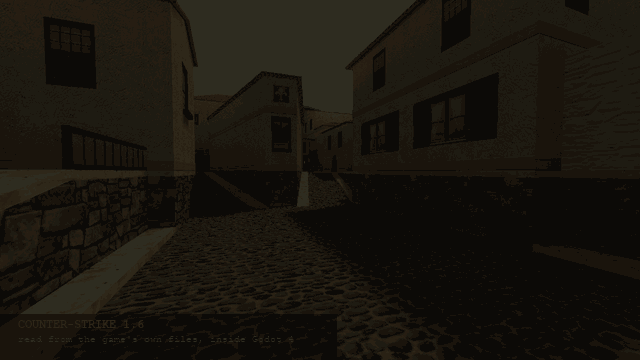

# Quebratsk 2.5.0 "Backalley"

We are back after a few months away, ready to keep bringing the best games to Godot.

The release where Half-Life 2 levels open, GoldSrc levels get their own light and their own
walls back, and the project drops "Engine" from its name.

## Install

1. Download `quebratsk-2.5.0-Backalley.zip` below.
2. Unzip it into your Godot project, next to `project.godot`. You get `bin/` and
   `addons/quebratsk_editor/`.
3. Close Godot and open the project again, then tick **Quebratsk** under
   **Project → Project Settings → Plugins**.

Godot 4.3 or newer, Windows x86_64. Coming from 2.1: replace both folders. Class names and
paths have not changed, so your scenes keep working.

## Half-Life 2 levels open

The Source level reader is in C++ now: faces, displacements, HDR light, brush entities and
static props, plus the files a mapper packed inside the `.bsp`. On the Shipped test level that
is **766 entities, 25 brush entities and 3,726 of 3,736 props from 226 models**.

People and props are lit from the light the level stores for things that move, and particle
files (PCF and DMX) are read, which is where the muzzle flash comes from. Source models bring
their attachment points and skin families.

Not there yet: water draws white, and only a few levels have been checked.

## GoldSrc levels look and feel like the game

- **Baked light.** The light a map was compiled with is read and used, and the painted sky is
  built from its six pictures. It had been a mirror image before.
- **Real walls.** Collision is rebuilt from the map's clip hulls instead of a shell of its
  faces, so you stop where the game stops you.
- **Sprites.** They did not decode at all for most retail files. Checked against an
  independent decoder: **1,361 of 1,361 identical**.

## Measured against the games

A corpus scanner and four format validators check every WAD3, BSP30, MDL10 and SPR file of a
retail install: **5,196 files, 0 hard errors.** Each struct the engine reads is pinned to the
same offsets with `static_assert`.

## The lab

`demo/` opens a Counter-Strike map and puts you in it. New since 2.1: doors, buttons, lifts
and breakables, ladders and water on the engine's own rules, footsteps that match the floor,
rooms that sound like rooms, blood and bullet holes, hostages, ammo and reloads, and people lit
by the floor they stand on.

## Everything else

[CHANGELOG.md](https://github.com/9mirx0r/Quebratsk-Engine/blob/main/CHANGELOG.md) has every
change and the number behind it.
